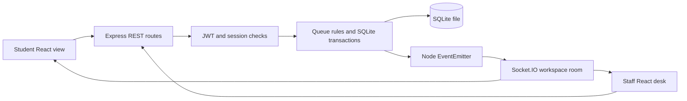
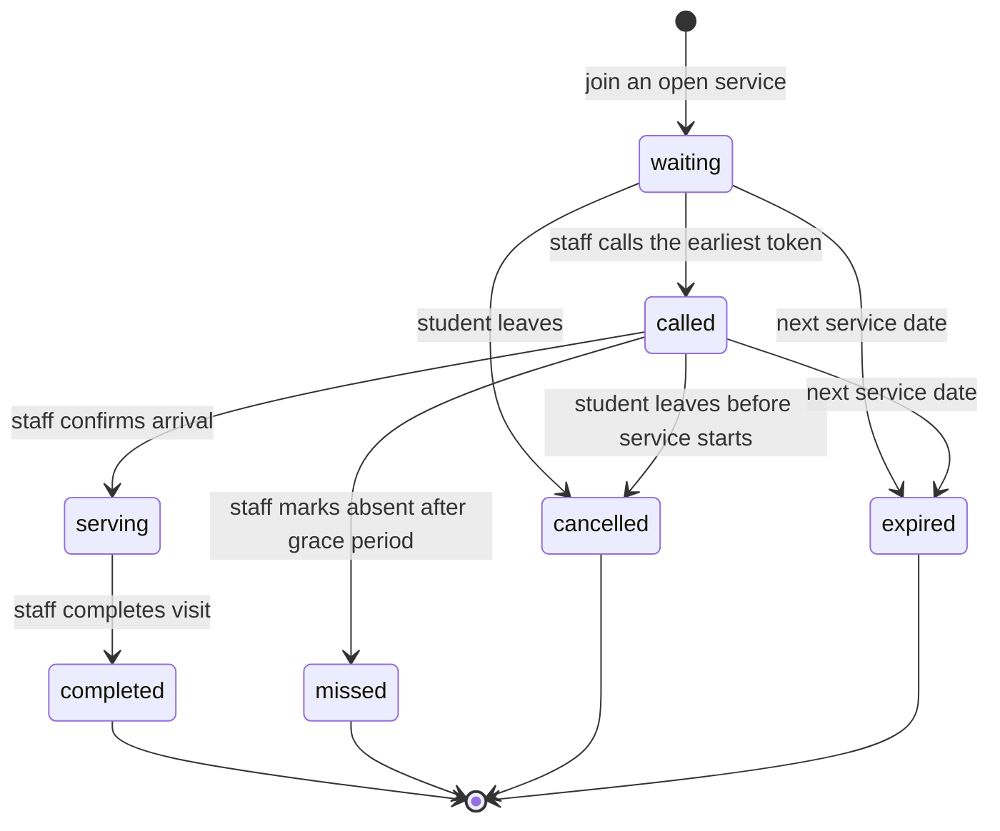

# Architecture and queue rules

## Request path

`src/App.jsx` contains student, desk, history, service-management, display and form
components. `src/api.js` supplies the HTTP client. The app uses the browser History
API for navigation and React state/effects to refresh the displayed records.

`server/app.js` owns validation, authentication boundaries, REST routes and CSV
responses. `server/auth.js` hashes passwords, signs/verifies JWTs and checks stored
sessions. `server/store.js` owns the schema, read models, state transitions and
transactions. `server/index.js` starts the native HTTP server and Socket.IO,
serves the built React app and handles shutdown.

## Data

Workspaces own users and services. Services own dated tickets. Tickets reference
their student; their immutable issued token is kept even when a service prefix
changes. Audit rows record successful mutations. Request rows cache idempotent
responses per actor and request key. Sessions support logout revocation.

Database constraints enforce one active token per student and one called/serving
token per counter. SQLite `BEGIN IMMEDIATE` surrounds each mutation. A service
version is compared inside that transaction for staff actions. All queries bind
parameters. Live data is not stored in React or a shared demo JSON file.

## State machine

A new join after a terminal state creates a new ticket at the end. Paused services
retain tickets but block new joins/calls. Closed services finish their existing
queue. An overnight serving ticket is retained and must finish before another
visitor can occupy the counter. Day rollover is evaluated on requests, with the
interface refreshing every 15 seconds even if no socket event arrives.

## Privacy and live updates

The JWT identifies a session. The server reloads the user's role/workspace instead
of trusting a browser-selected role. Only the owner can cancel a student's ticket.
Staff may view records only in their workspace. Public summaries omit names,
emails, user identifiers and visit reasons.

Socket rooms are selected by the authenticated server. Broadcasts contain only a
change notice, not visitor data. Clients then request a fresh permitted view.
Reconnection triggers a refresh; a periodic refresh provides a fallback. Public
unauthenticated displays refresh every 15 seconds.

## Estimates and limits

For `n` visitors ahead and average duration `m`, the displayed range is roughly
`floor(0.8*n*m)` to `ceil(1.2*(n+0.5)*m)` minutes. It is deliberately a range and does
not pretend to know exactly when a current visit will finish. At least three
completed durations between 30 seconds and 60 minutes are needed before a rolling
mean of the latest 20 suitable durations replaces the configured average.

This version has one counter per service, no appointment scheduling, no automatic
priority jumping, no SMS and no external identity verification. Registration does
not verify ownership of an email address. JWTs are kept in browser session storage,
so the app avoids untrusted HTML rendering and serves a restrictive production CSP.
SQLite runs synchronously in one Node process; scaling to a large multi-instance
installation would need different database and socket infrastructure.
